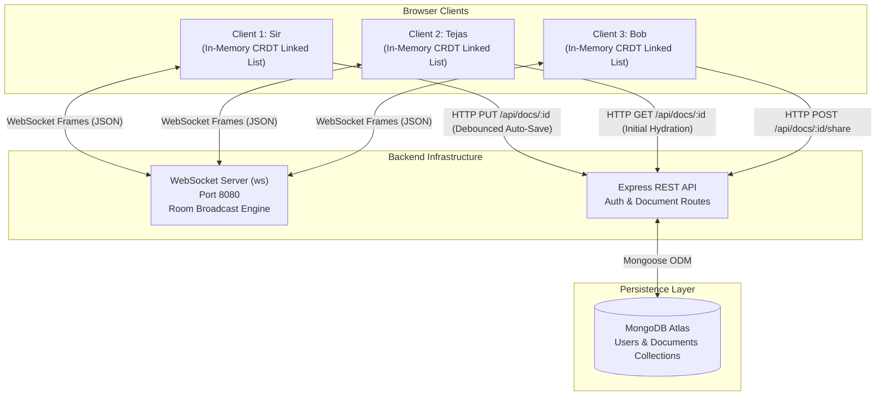
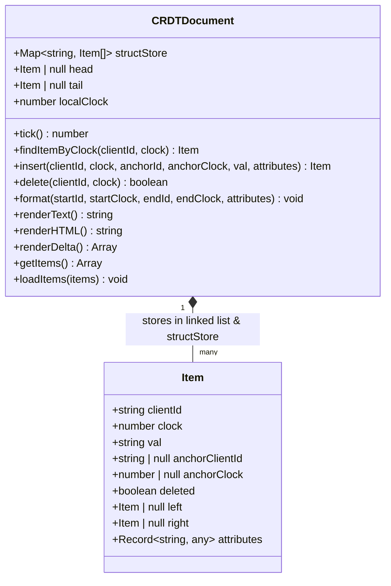
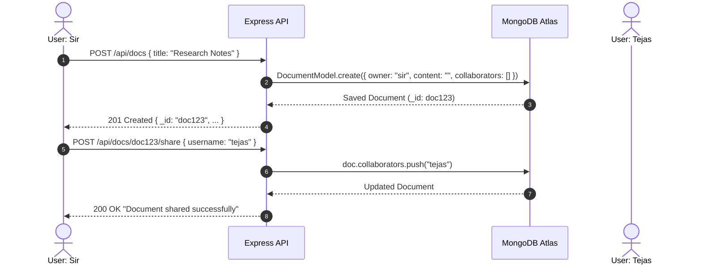
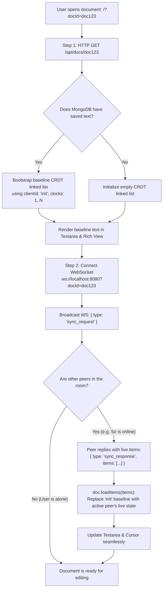
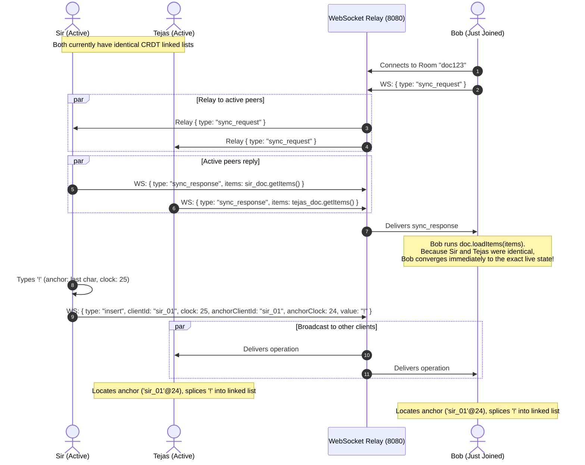
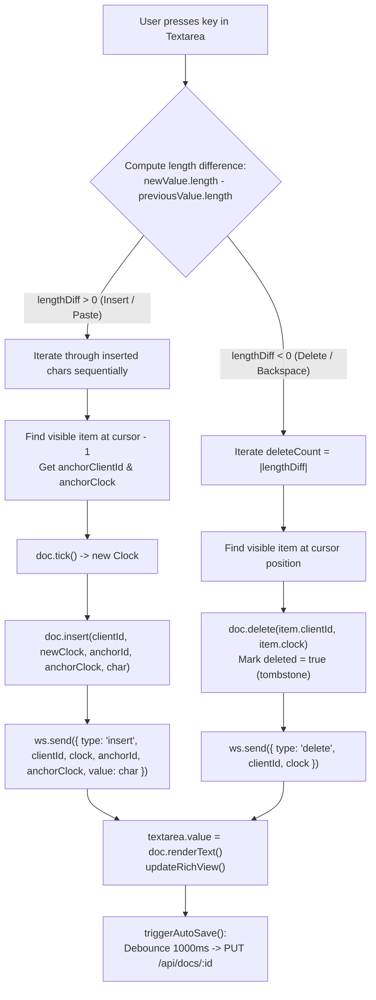

# Distributed CRDT Editor Engine — Architecture & Specification

This document provides a comprehensive architectural breakdown, mathematical data structure specification, sequence diagrams, and operational flowcharts for the real-time collaborative text editor engine.

---

## 1. High-Level System Architecture

The distributed editor engine consists of a client-side Conflict-free Replicated Data Type (CRDT) linked-list engine running in the browser, an asynchronous WebSocket relay room server, an Express REST API for persistence and user authentication, and a MongoDB Atlas database for document storage.



---

## 2. In-Memory CRDT Data Structure

The editor uses a sequence CRDT implemented as an in-memory **Doubly Linked List** backed by a **Hash Map (`structStore`)** for fast random-access anchor resolution.



### 2.1 The `Item` Object
Every character in the document is encapsulated in an `Item` node:
* `clientId`: Unique identifier of the client who typed the character (e.g., `"sir_280"`).
* `clock`: Lamport logical clock counter when the keystroke occurred.
* `val`: The single character string (e.g., `"a"`, `"\n"`, `" "`).
* `anchorClientId` & `anchorClock`: Coordinates of the character immediately to the left at the time of typing.
* `deleted`: Tombstone boolean flag. Characters are soft-deleted to maintain anchor continuity for concurrent edits.
* `left` & `right`: Pointers to adjacent items in document display order.
* `attributes`: Typography styling (bold, italic, underline, color, font, size, script).

### 2.2 $O(\log K)$ Binary Search Anchor Resolution (`structStore`)
Because inserting into a raw linked list can require $O(N)$ traversal, `structStore` organizes items by `clientId` in arrays sorted by `clock`. When an incoming remote operation arrives anchoring to `(anchorClientId, anchorClock)`, the anchor item is located in $O(\log K)$ time using binary search.

### 2.3 Deterministic Tie-Breaking Loop
When two clients type simultaneously at the exact same anchor position, both items are candidates for the slot. The CRDT resolves this deterministically across all nodes without a central authority:

$$\text{Priority}(A) > \text{Priority}(B) \iff (A.\text{clock} > B.\text{clock}) \lor (A.\text{clock} = B.\text{clock} \land A.\text{clientId} > B.\text{clientId})$$

If item $A$ has a higher priority, it sits to the left; otherwise, it is spliced to the right. All machines compute identical positions independently.

---

## 3. End-to-End Operational Lifecycle & Sequence Diagrams

### 3.1 Document Creation and Sharing


---

### 3.2 Offline Hydration vs. Real-Time Peer Sync

When a collaborator opens a document, the system executes a 2-step hydration sequence:



---

### 3.3 Live Multi-Peer Collaboration (3 Collaborators)

When Sir, Tejas, and Bob are online together, all keystrokes are broadcast as operations through the WebSocket server:



---

## 4. Keystroke & Delete Event Pipeline



---

## 5. Wire Protocol Payloads

All WebSocket payloads transmitted through the server room are structured JSON text frames:

### 5.1 Insert Operation
```json
{
  "type": "insert",
  "clientId": "sir_280",
  "clock": 15,
  "anchorClientId": "sir_280",
  "anchorClock": 14,
  "value": "w",
  "attributes": {
    "bold": true,
    "color": "#1a73e8"
  }
}
```

### 5.2 Delete Operation
```json
{
  "type": "delete",
  "clientId": "sir_280",
  "clock": 15
}
```

### 5.3 Format Operation
```json
{
  "type": "format",
  "startClientId": "sir_280",
  "startClock": 10,
  "endClientId": "sir_280",
  "endClock": 15,
  "attributes": {
    "italic": true,
    "font": "Georgia"
  }
}
```

### 5.4 Synchronization Handshake
```json
// Client Request
{
  "type": "sync_request"
}

// Peer Response
{
  "type": "sync_response",
  "items": [
    {
      "clientId": "sir_280",
      "clock": 1,
      "val": "H",
      "anchorClientId": null,
      "anchorClock": null,
      "deleted": false,
      "attributes": {}
    },
    {
      "clientId": "sir_280",
      "clock": 2,
      "val": "i",
      "anchorClientId": "sir_280",
      "anchorClock": 1,
      "deleted": false,
      "attributes": {}
    }
  ]
}
```
