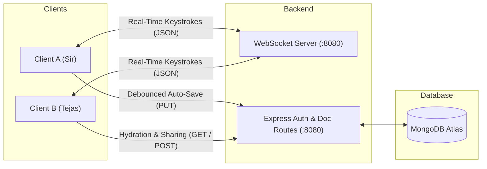

# Distributed CRDT Editor Engine

A Google Docs-style real-time collaborative rich-text editor powered by a Conflict-free Replicated Data Type (CRDT) sequence engine implemented in TypeScript. Features rich typography styling, instant peer-to-peer WebSocket synchronization, and persistent MongoDB storage.

---

## Key Features

* **Custom TypeScript CRDT Engine**: Sequence CRDT implemented as a doubly-linked list with $O(\log K)$ binary search lookup (`structStore`) and Lamport logical clocks for deterministic conflict resolution.
* **Real-Time Collaboration**: Sub-millisecond keystroke broadcasting via WebSocket room channels.
* **Character-Level Typography Formatting**: Per-character attribute styling (bold, italic, underline, strikethrough, monospace, subscript, superscript, font family, font size, text color, and background highlight).
* **Deterministic Tie-Breaking**: Mathematical priority sorting using `(clock, clientId)` pairs prevents divergent states across peers.
* **Peer-to-Peer State Sync**: Automatically aligns newly joined collaborators using live `sync_request` / `sync_response` handshakes.
* **Session-Isolated Authentication**: Per-tab session storage prevents token collisions when testing multiple users concurrently in the same browser.
* **Debounced Auto-Save**: Seamless persistence pipeline updating MongoDB Atlas in the background without UI blocking.

---

## System Architecture



> For deep architectural specifications, data structures, and sequence diagrams, see [ARCHITECTURE.md](ARCHITECTURE.md).

---

## Tech Stack

* **Frontend**: TypeScript, HTML5 ContentEditable/Textarea canvas, WebSockets, SPA Hashless Router.
* **Backend**: Node.js, Express, `ws` (WebSocket Server), JWT Authentication, Bcrypt.
* **Database**: MongoDB Atlas with Mongoose ODM.

---

## Getting Started

### 1. Prerequisites
* Node.js (v18+)
* npm (v9+)
* MongoDB Atlas connection string (or local MongoDB instance)

### 2. Environment Configuration
Ensure `backend/.env` contains your MongoDB connection string and JWT secret:
```env
MONGO_URI=mongodb+srv://<username>:<password>@cluster0.mongodb.net/crdt-editor
PORT=8080
JWT_SECRET=super_secret_jwt_key_change_in_production
```

### 3. Installation & Build

#### Backend Setup
```bash
cd backend
npm install
npm run build
npm start
```
*Backend runs on `http://localhost:8080`.*

#### Frontend Setup
In a new terminal:
```bash
cd frontend
npm install
npm run build
npm run dev
```
*Frontend runs on `http://localhost:3000`.*

---

## Testing Real-Time Collaboration

1. Open `http://localhost:3000` in **Tab 1**. Register/Login as `sir` (password: `sir`).
2. Create a new document by clicking **"+ New Document"**.
3. Click the **"Share"** button in the header and share the document with username `tejas`.
4. Open `http://localhost:3000` in **Tab 2**. Register/Login as `tejas` (password: `tejas`).
5. In Tab 2, click the shared document under **"Shared with me"**.
6. Type in Tab 1: keystrokes, formatting, and deletions reflect instantly in Tab 2 in real time.
